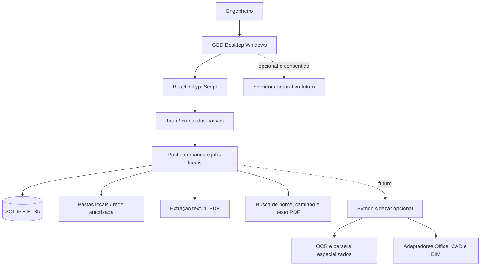
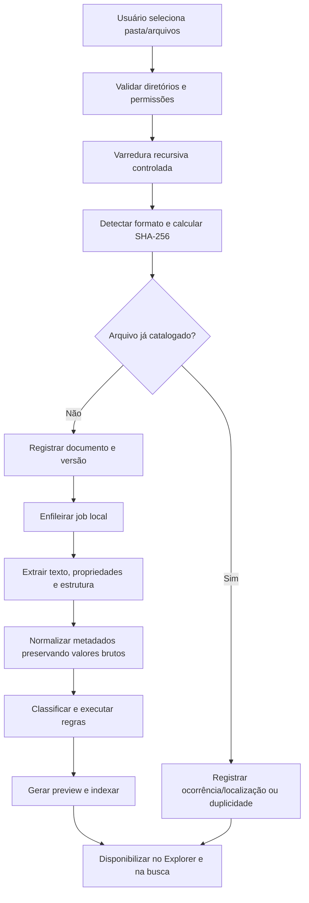

# Arquitetura desktop do GED

## 1. Decisão principal

O GED é um **aplicativo desktop Windows**, instalado localmente e distribuído como `.exe`/instalador. Não é um SaaS nem uma aplicação cujo uso normal dependa do navegador.

### Stack

- Tauri 2: shell desktop, janela, menus, permissões e empacotamento.
- React + TypeScript: interface.
- Rust/Tauri: indexação local, hash, operações nativas, extração textual de PDF e comandos do catálogo.
- SQLite: catálogo, metadados, auditoria e índices FTS5 de nome/caminho e conteúdo PDF.
- Python: motor experimental separado para parsers e análises especializadas; ainda não empacotado nem conectado como sidecar do executável.
- OCR e adaptadores Office/CAD/BIM: componentes futuros, sujeitos a provas técnicas e validação de licença.
- Sistema de arquivos: originais e derivados locais.
- Serviços externos opcionais: somente para sincronização, IA remota ou integrações explicitamente habilitadas.

O aplicativo deve operar offline para importação local, pesquisa, classificação, análise, visualização suportada e exportação.

## 2. Diagrama de contexto



## 3. Organização do código

```text
gerenciador-de-dados/
  apps/
    desktop/                 # Tauri 2 + React + TypeScript
      src/                   # telas, componentes, estado
      src-tauri/             # Rust commands, permissões, bundler
  services/
    indexer/                 # Python experimental / CLI, ainda não integrado
      src/ged_indexer/       # scanner, nomes e protótipo PDF
      tests/                 # testes pytest
  installer/                 # ícones, configuração e scripts
  docs/
```

## 4. Fluxo de importação local



Não copiar nem mover arquivos por padrão: catalogar no local de origem e manter o original intacto. Oferecer cópia para uma biblioteca gerenciada apenas como ação explícita.

## 5. Domínios

- Workspace/Profile: perfil local e configuração.
- Project Registry: obras, contratos, locais e disciplinas.
- Document Catalog: documentos, versões, caminhos e hashes.
- Ingestion: varredura, detecção, extração e jobs.
- Metadata & Taxonomy: campos normalizados, taxonomia e proveniência.
- Search: texto completo, filtros e similaridade local.
- Quality & Findings: divergências, duplicidades e revisão humana.
- Comparison: diferenças entre versões/documentos.
- Recommendation: referências semelhantes e justificativas.
- Preview: miniaturas e derivados.
- Export & Reporting: relatórios, planilhas e pacotes.
- Audit: trilha local das operações.

## 6. Banco e armazenamento

SQLite é a fonte primária no MVP. Usar transações, WAL quando adequado, foreign keys, índices, FTS5 e migrações versionadas. O banco fica em diretório de dados do usuário, separado do diretório de instalação.

Os arquivos originais permanecem nos caminhos escolhidos pelo usuário. O GED guarda metadados, hash, caminho, tamanho, datas e resultados de extração. Previews, thumbnails, cache e exports ficam em diretórios próprios do GED. Deve existir ferramenta para relocalizar raiz de biblioteca e reparar caminhos quebrados.

Para grandes volumes, evitar carregar arquivos inteiros na memória. Processar em streaming e limitar concorrência configurável.

## 7. Comunicação entre interface e motor

O executável atual usa comandos Tauri e tarefas `spawn_blocking` para indexação e extração de PDF; o texto é persistido no SQLite do desktop. O Python indexer é experimental e não é iniciado pelo aplicativo. Se um sidecar for integrado no futuro, deverá usar IPC local restrito, reportar saúde/versão, suportar timeout/cancelamento e nunca expor uma API aberta na rede local.

## 8. Divergências

1. Extrair valores candidatos de nome, carimbo, propriedades internas e tabelas.
2. Preservar cada valor com origem, método, confiança e localização (página/folha/entidade/coordenadas).
3. Normalizar apenas para comparar; preservar o bruto.
4. Aplicar regras versionadas por tipo de documento/disciplina.
5. Criar achados com severidade, evidência e estado.
6. Permitir confirmar, rejeitar, resolver ou aceitar risco com justificativa.
7. Auditar decisões.

Divergência é alerta para revisão, não conclusão automática de erro ou não conformidade.

## 9. Busca e recomendação local

- FTS5 para nome/caminho e conteúdo textual de PDFs já extraídos; título e identificadores estruturados entram gradualmente.
- Filtros estruturados: obra, rodovia, trecho, ramo, disciplina, tipo, etapa, revisão, data, escala e formato.
- Similaridade lexical e técnica por atributos normalizados.
- Embeddings locais opcionais, ativados conforme hardware e licença/modelo.
- Ranking explicável: exibir atributos coincidentes, diferenças e dados ausentes.

Nunca recomendar projeto como tecnicamente aplicável apenas por similaridade. A decisão é do engenheiro responsável.

## 10. Formatos CAD/BIM

Implementar adaptadores com capacidades declaradas por formato/versão. DWG e RVT podem exigir SDKs ou licenças comerciais. Fazer prova de conceito com os DWGs reais antes de escolher biblioteca. Não converter silenciosamente nem alterar o original.

## 11. Segurança desktop

- Permissões nativas Tauri com allowlist mínima.
- Acesso a pastas somente após seleção/autorização do usuário.
- Não executar macros, scripts ou conteúdo ativo dos documentos.
- Processar arquivos potencialmente maliciosos em subprocessos isolados, com limites de tempo/memória.
- Guardar tokens/segredos no armazenamento seguro do sistema operacional quando necessário.
- Não enviar documentos para nuvem sem consentimento explícito.
- Logs sem conteúdo sensível; auditoria de importação, edição, exportação e exclusão.
- Backup do catálogo e opção de backup dos arquivos gerenciados.
- Assinatura do instalador e atualização segura antes de distribuição ampla.

## 12. Evolução multiusuário

A primeira versão é local e single-user/perfil local. Para colaboração futura, adicionar serviço de sincronização e API corporativa como módulo opcional, com conflitos de sincronização, identidade central e PostgreSQL no servidor. Não introduzir PostgreSQL, Redis, MinIO ou dependência de nuvem no MVP desktop.
