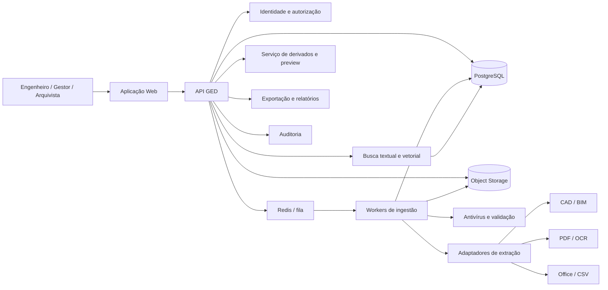
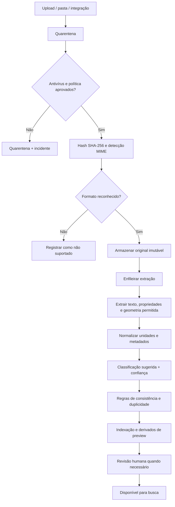

# Arquitetura do GED

## 1. Decisões arquiteturais

### 1.1 Monólito modular + workers assíncronos

Começar com uma API FastAPI organizada por domínio e processos de background separados. Evitar microserviços prematuros. Os módulos devem comunicar-se por interfaces internas e eventos de domínio; extraí-los para serviços independentes somente quando escala, isolamento ou equipes justificarem.

### 1.2 Contextos de domínio

- Identity & Access: usuários, grupos, papéis, workspaces e políticas.
- Project Registry: obras, contratos, empreendimentos, locais e disciplinas.
- Document Vault: arquivos, versões, hashes, armazenamento e retenção.
- Ingestion: upload, antivírus, detecção de formato, extração e normalização.
- Metadata & Taxonomy: campos normalizados, taxonomias e proveniência.
- Search: pesquisa textual, filtros, facetas e vetores.
- Quality & Findings: regras, divergências, duplicidades e revisão humana.
- Comparison: diferenças entre versões e documentos relacionados.
- Recommendation: candidatos semelhantes, explicações e feedback.
- Preview: geração de derivados seguros para visualização.
- Export & Reporting: relatórios, pacotes, planilhas e manifestos.
- Audit: trilha imutável de ações relevantes.

## 2. Diagrama de contexto

## 3. Pipeline de ingestão

Cada etapa deve ser idempotente: reprocessar o mesmo arquivo não deve criar documentos duplicados. Usar chave de idempotência baseada em workspace, hash, versão do pipeline e parâmetros.

## 4. Pipeline de divergências

1. Extrair valores candidatos de fontes distintas (nome, carimbo, propriedades internas, planilha de controle, metadados do usuário).
2. Preservar cada valor com origem, página/folha/entidade, coordenadas quando disponíveis, método e confiança.
3. Normalizar apenas para comparação, preservando o texto original.
4. Aplicar regras versionadas e específicas do workspace/disciplina.
5. Criar achados com severidade, evidência, explicação e estado.
6. Permitir confirmação, rejeição ou correção por profissional autorizado.
7. Registrar auditoria e manter histórico das decisões.

Exemplos de regras:
- Número do desenho no nome diferente do número identificado no carimbo.
- Título do carimbo diferente do título cadastrado para o mesmo identificador.
- Revisão no nome diferente da revisão interna.
- Mesmo hash em caminhos diferentes (duplicidade exata).
- Mesmo identificador com títulos, revisões ou disciplinas conflitantes.
- Referência cruzada a arquivo ausente.
- Unidade, escala ou sistema de coordenadas divergente, somente quando os campos e regras aplicáveis forem conhecidos.

**Importante:** divergência é um sinal para revisão, não uma conclusão automática de erro de projeto ou não conformidade normativa.

## 5. Adaptadores de formato

Criar interface comum `DocumentAdapter`:
- `detect(file)`
- `extract_metadata(file)`
- `extract_text(file)`
- `extract_structure(file)`
- `render_preview(file)`
- `compare(a, b)` quando houver implementação confiável
- `capabilities()`

Cada adaptador informa formatos e versões efetivamente suportados, limitações, dependências externas e se a operação é somente leitura ou permite conversão.

Não prometer leitura ou exportação universal. DWG/DXF, RVT, DGN e outros formatos proprietários podem depender de SDKs, serviços comerciais ou conversores com licenças específicas. Manter o original e exportar o original sem conversão sempre que permitido.

## 6. Busca e recomendação

### Busca híbrida
- Filtros estruturados: obra, rodovia, trecho, ramo, disciplina, tipo, etapa, revisão, data, autor, escala, formato e estado.
- Texto completo: nome, título, conteúdo extraído, notas e identificadores.
- Semântica: embeddings de título, descrição e trechos textuais, com filtros de autorização aplicados antes de retornar resultados.
- Similaridade técnica: atributos normalizados, geometria quando disponível, sistema construtivo, tipologia, dimensões e contexto.

### Ranking inicial (configurável)
- 35% correspondência de atributos técnicos;
- 25% correspondência textual/semântica;
- 20% contexto de obra, local e disciplina;
- 10% tipologia e etapa;
- 10% qualidade/completude dos metadados.

Os pesos são hipótese inicial, não verdade universal. Devem ser calibrados com avaliação dos engenheiros e feedback explícito. Exibir por que cada resultado foi recomendado.

## 7. Segurança e confiabilidade

- Autenticação OIDC/OAuth2; MFA conforme provedor.
- RBAC por workspace e projeto; considerar ABAC para sigilo, contrato e classificação.
- Isolamento por tenant/workspace em todas as consultas.
- Criptografia em trânsito e repouso; gestão de chaves fora do código.
- Antivírus, limites de tamanho, rate limiting e validação MIME/magic bytes.
- Não executar macros, scripts ou conteúdo ativo de documentos.
- Workers isolados, sem acesso desnecessário à rede, com limites de CPU, memória e tempo.
- URLs assinadas e temporárias para download.
- Logs sem conteúdo sensível; trilha de auditoria para ações críticas.
- Backup, restauração testada, retenção e política de descarte.
- LGPD: finalidade, minimização, controle de acesso, retenção e atendimento a titulares quando houver dados pessoais.
- Segredos em secret manager/variáveis protegidas; nunca no repositório.

## 8. Observabilidade e operação

Métricas: arquivos recebidos, taxa de extração, falhas por formato, tempo por etapa, fila pendente, taxa de revisão humana, falsos positivos das regras, qualidade da busca, tempo de resposta e erros de exportação.

Logs estruturados com correlation_id, document_id, workspace_id e pipeline_version. Instrumentar traces entre API, fila e workers. Criar alertas para fila parada, falha de armazenamento, crescimento de erros e indisponibilidade.

## 9. Implantação evolutiva

- Desenvolvimento: Docker Compose (API, frontend, PostgreSQL, Redis, MinIO).
- Piloto: serviços gerenciados ou VMs com backup, observabilidade e storage redundante.
- Escala: workers horizontais, OpenSearch dedicado, cache, CDN para previews e serviços especializados CAD/BIM.
