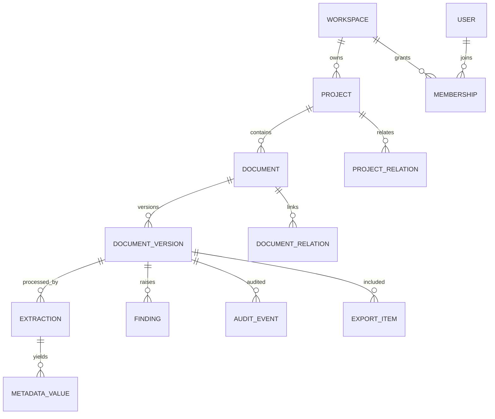

# Modelo de dados e schema

## 0. Banco da aplicação desktop

No MVP Windows, o banco efetivo será **SQLite local**, armazenado no diretório de dados do usuário, fora da pasta de instalação. Usar foreign keys, WAL quando apropriado, FTS5, índices e migrações versionadas. O GED registra versões aplicadas em `schema_migrations`; a migração inicial de compatibilidade e os índices básicos do catálogo já estão registrados no código desktop. O conteúdo binário dos documentos permanece nos caminhos originais ou na biblioteca local gerenciada; o banco guarda referências, hashes e metadados.

O schema PostgreSQL apresentado adiante deve ser entendido como **referência para uma futura edição corporativa/sincronizada**, não como dependência do executável inicial. O modelo lógico é compartilhado, mas as migrações SQLite precisam adaptar tipos (UUID, JSON, timestamps), índices, FTS5 e constraints às capacidades do SQLite. Não exigir PostgreSQL, Redis, MinIO ou conexão com servidor para instalar e usar o MVP.

## 1. Princípios

- Separar projeto lógico, documento, versão física e extrações.
- Versões são imutáveis; correções geram nova extração ou anotação, não alteram o original.
- Metadados têm proveniência: origem, método, confiança, versão do extrator e localização no documento.
- Campos comuns são normalizados; propriedades específicas ficam em JSONB com esquema validado.
- Todas as entidades de negócio pertencem a um workspace.
- IDs UUID; timestamps UTC; unidades e sistemas de referência explícitos.

## 2. Entidades e relações



## 3. Schema SQL de referência (PostgreSQL)

O SQL abaixo é uma base inicial. Deve ser aplicado por migrações versionadas e revisado antes de produção. Extensões e políticas RLS devem ser habilitadas conforme ambiente.

```sql
CREATE EXTENSION IF NOT EXISTS pgcrypto;
CREATE EXTENSION IF NOT EXISTS citext;
-- Habilitar pgvector apenas nos ambientes que utilizarem embeddings.
CREATE EXTENSION IF NOT EXISTS vector;

CREATE TABLE workspaces (
  id uuid PRIMARY KEY DEFAULT gen_random_uuid(),
  name text NOT NULL,
  slug text NOT NULL UNIQUE,
  created_at timestamptz NOT NULL DEFAULT now()
);

CREATE TABLE users (
  id uuid PRIMARY KEY DEFAULT gen_random_uuid(),
  oidc_subject text NOT NULL UNIQUE,
  email citext UNIQUE,
  display_name text NOT NULL,
  active boolean NOT NULL DEFAULT true,
  created_at timestamptz NOT NULL DEFAULT now()
);

CREATE TABLE memberships (
  workspace_id uuid NOT NULL REFERENCES workspaces(id),
  user_id uuid NOT NULL REFERENCES users(id),
  role text NOT NULL CHECK (role IN ('owner','admin','engineer','reviewer','archivist','viewer')),
  created_at timestamptz NOT NULL DEFAULT now(),
  PRIMARY KEY (workspace_id, user_id)
);

CREATE TABLE projects (
  id uuid PRIMARY KEY DEFAULT gen_random_uuid(),
  workspace_id uuid NOT NULL REFERENCES workspaces(id),
  code text,
  name text NOT NULL,
  description text,
  project_type text,
  discipline text[],
  stage text,
  client text,
  contractor text,
  location_name text,
  municipality text,
  state_code char(2),
  country_code char(2) DEFAULT 'BR',
  status text NOT NULL DEFAULT 'active',
  attributes jsonb NOT NULL DEFAULT '{}'::jsonb,
  created_by uuid REFERENCES users(id),
  created_at timestamptz NOT NULL DEFAULT now(),
  updated_at timestamptz NOT NULL DEFAULT now(),
  UNIQUE (workspace_id, code)
);
CREATE INDEX projects_workspace_idx ON projects(workspace_id);
CREATE INDEX projects_attributes_gin ON projects USING gin(attributes);

CREATE TABLE documents (
  id uuid PRIMARY KEY DEFAULT gen_random_uuid(),
  workspace_id uuid NOT NULL REFERENCES workspaces(id),
  project_id uuid REFERENCES projects(id),
  parent_document_id uuid REFERENCES documents(id),
  logical_path text,
  display_name text NOT NULL,
  current_version_id uuid,
  document_type text,
  discipline text,
  lifecycle_state text NOT NULL DEFAULT 'active',
  sensitivity text NOT NULL DEFAULT 'internal',
  created_by uuid REFERENCES users(id),
  created_at timestamptz NOT NULL DEFAULT now(),
  updated_at timestamptz NOT NULL DEFAULT now()
);
CREATE INDEX documents_workspace_project_idx ON documents(workspace_id, project_id);
CREATE INDEX documents_name_idx ON documents USING gin (to_tsvector('simple', display_name));

CREATE TABLE document_versions (
  id uuid PRIMARY KEY DEFAULT gen_random_uuid(),
  document_id uuid NOT NULL REFERENCES documents(id),
  version_label text,
  original_filename text NOT NULL,
  detected_mime text,
  extension text,
  byte_size bigint NOT NULL CHECK (byte_size >= 0),
  sha256 char(64) NOT NULL,
  object_key text NOT NULL,
  source_path text,
  source_modified_at timestamptz,
  uploaded_by uuid REFERENCES users(id),
  uploaded_at timestamptz NOT NULL DEFAULT now(),
  is_original boolean NOT NULL DEFAULT true,
  UNIQUE (document_id, sha256)
);
CREATE INDEX document_versions_hash_idx ON document_versions(sha256);

ALTER TABLE documents
  ADD CONSTRAINT documents_current_version_fk
  FOREIGN KEY (current_version_id) REFERENCES document_versions(id)
  DEFERRABLE INITIALLY DEFERRED;

CREATE TABLE extractions (
  id uuid PRIMARY KEY DEFAULT gen_random_uuid(),
  document_version_id uuid NOT NULL REFERENCES document_versions(id),
  extractor_name text NOT NULL,
  extractor_version text NOT NULL,
  pipeline_version text NOT NULL,
  status text NOT NULL CHECK (status IN ('queued','running','succeeded','partial','failed','unsupported')),
  started_at timestamptz,
  finished_at timestamptz,
  error_code text,
  error_detail_safe text,
  extracted_text_key text,
  preview_key text,
  properties jsonb NOT NULL DEFAULT '{}'::jsonb,
  created_at timestamptz NOT NULL DEFAULT now()
);

CREATE TABLE metadata_values (
  id uuid PRIMARY KEY DEFAULT gen_random_uuid(),
  extraction_id uuid NOT NULL REFERENCES extractions(id),
  field_key text NOT NULL,
  raw_value text,
  normalized_value jsonb,
  source_kind text NOT NULL,
  source_locator jsonb NOT NULL DEFAULT '{}'::jsonb,
  confidence numeric(5,4) CHECK (confidence BETWEEN 0 AND 1),
  human_verified boolean NOT NULL DEFAULT false,
  verified_by uuid REFERENCES users(id),
  verified_at timestamptz,
  created_at timestamptz NOT NULL DEFAULT now()
);
CREATE INDEX metadata_field_lookup_idx ON metadata_values(field_key);
CREATE INDEX metadata_normalized_gin ON metadata_values USING gin(normalized_value);

CREATE TABLE findings (
  id uuid PRIMARY KEY DEFAULT gen_random_uuid(),
  workspace_id uuid NOT NULL REFERENCES workspaces(id),
  project_id uuid REFERENCES projects(id),
  document_version_id uuid REFERENCES document_versions(id),
  rule_code text NOT NULL,
  rule_version text NOT NULL,
  category text NOT NULL,
  severity text NOT NULL CHECK (severity IN ('info','low','medium','high','critical')),
  status text NOT NULL DEFAULT 'open'
    CHECK (status IN ('open','confirmed','rejected','resolved','accepted_risk')),
  title text NOT NULL,
  description text NOT NULL,
  evidence jsonb NOT NULL,
  confidence numeric(5,4) CHECK (confidence BETWEEN 0 AND 1),
  assigned_to uuid REFERENCES users(id),
  reviewed_by uuid REFERENCES users(id),
  reviewed_at timestamptz,
  resolution_note text,
  created_at timestamptz NOT NULL DEFAULT now(),
  updated_at timestamptz NOT NULL DEFAULT now()
);
CREATE INDEX findings_project_status_idx ON findings(workspace_id, project_id, status, severity);

CREATE TABLE document_relations (
  id uuid PRIMARY KEY DEFAULT gen_random_uuid(),
  source_document_id uuid NOT NULL REFERENCES documents(id),
  target_document_id uuid NOT NULL REFERENCES documents(id),
  relation_type text NOT NULL,
  confidence numeric(5,4),
  evidence jsonb NOT NULL DEFAULT '{}'::jsonb,
  created_at timestamptz NOT NULL DEFAULT now(),
  CHECK (source_document_id <> target_document_id)
);

CREATE TABLE embeddings (
  id uuid PRIMARY KEY DEFAULT gen_random_uuid(),
  document_version_id uuid NOT NULL REFERENCES document_versions(id),
  model_name text NOT NULL,
  chunk_index integer NOT NULL,
  content_hash char(64) NOT NULL,
  chunk_text text NOT NULL,
  embedding vector(1536),
  metadata jsonb NOT NULL DEFAULT '{}'::jsonb,
  UNIQUE(document_version_id, model_name, chunk_index)
);

CREATE TABLE ingestion_jobs (
  id uuid PRIMARY KEY DEFAULT gen_random_uuid(),
  workspace_id uuid NOT NULL REFERENCES workspaces(id),
  idempotency_key text NOT NULL,
  status text NOT NULL,
  total_items integer NOT NULL DEFAULT 0,
  processed_items integer NOT NULL DEFAULT 0,
  failed_items integer NOT NULL DEFAULT 0,
  created_by uuid REFERENCES users(id),
  created_at timestamptz NOT NULL DEFAULT now(),
  finished_at timestamptz,
  UNIQUE(workspace_id, idempotency_key)
);

CREATE TABLE export_jobs (
  id uuid PRIMARY KEY DEFAULT gen_random_uuid(),
  workspace_id uuid NOT NULL REFERENCES workspaces(id),
  requested_by uuid NOT NULL REFERENCES users(id),
  format text NOT NULL,
  selection jsonb NOT NULL,
  status text NOT NULL,
  result_object_key text,
  manifest jsonb,
  expires_at timestamptz,
  created_at timestamptz NOT NULL DEFAULT now(),
  finished_at timestamptz
);

CREATE TABLE audit_events (
  id bigserial PRIMARY KEY,
  workspace_id uuid NOT NULL REFERENCES workspaces(id),
  actor_user_id uuid REFERENCES users(id),
  action text NOT NULL,
  entity_type text NOT NULL,
  entity_id uuid,
  occurred_at timestamptz NOT NULL DEFAULT now(),
  correlation_id uuid,
  details jsonb NOT NULL DEFAULT '{}'::jsonb
);
CREATE INDEX audit_workspace_time_idx ON audit_events(workspace_id, occurred_at DESC);
```

> Observações de implementação: habilitar `citext` antes de usar o tipo (`CREATE EXTENSION IF NOT EXISTS citext;`). A dimensão do vetor deve corresponder ao modelo de embedding escolhido; não fixar 1536 se o provedor usar outra dimensão. Avaliar particionamento, políticas RLS, índices e retenção com dados reais.

## 4. Metadados técnicos recomendados

### Identificação documental
- número do desenho; código interno; código do cliente/órgão;
- título; subtítulo; revisão; status de emissão;
- data; autor; verificador; aprovador;
- disciplina; especialidade; tipo documental; etapa.

### Engenharia civil
- empreendimento, contrato, lote, trecho, rodovia, ramo, estaca/km;
- tipologia (ponte, viaduto, drenagem, terraplenagem, pavimentação, contenção etc.);
- material/sistema construtivo;
- unidades, escala, cotas e sistema de coordenadas quando aplicáveis;
- normas e especificações declaradas no documento (sem inferir conformidade);
- quantitativos e referências cruzadas quando extraíveis com confiabilidade.

### Proveniência obrigatória por campo
`source_kind`: filename | title_block | document_property | table | OCR | user | external_register.
`source_locator`: página, folha, bloco, entidade CAD, coordenada, célula ou trecho.
`confidence`: score calibrado por adaptador; null quando não estimável.
`extractor_version`: versão do processo que produziu o valor.

## 5. Exemplo de regra de divergência

```json
{
  "rule_code": "DRAWING_NUMBER_MISMATCH",
  "rule_version": "1.0.0",
  "category": "identification",
  "severity": "high",
  "inputs": [
    {"field": "drawing_number", "source": "filename"},
    {"field": "drawing_number", "source": "title_block"}
  ],
  "normalization": "trim-uppercase-remove-separators",
  "condition": "normalized_values_differ",
  "result": "finding",
  "requires_human_review": true
}
```

A regra precisa permitir exceções por padrão documental, organização, órgão e disciplina. Não aplicar normalização que apague diferenças significativas de identificadores.


## 6. Schema SQLite efetivamente implementado no MVP desktop

O schema PostgreSQL acima é referência para uma futura edição corporativa. O executável atual usa SQLite e tem as seguintes entidades implementadas:

| Tabela | Responsabilidade |
|---|---|
| `scan_roots` | Pastas físicas autorizadas para indexação |
| `scan_runs` | Execuções de varredura e estado da reconciliação |
| `files` | Referências a arquivos originais, caminho, tamanho, hash e status |
| `file_versions` | Histórico de hashes, tamanho e datas; não guarda cópias binárias |
| `projects` | Catálogo lógico de projetos, com código, cliente e status |
| `project_roots` | Relação reutilizável entre projetos e pastas indexadas |
| `project_disciplines` | Disciplinas configuráveis por projeto |
| `project_file_links` | Associação individual de documentos a projetos e disciplinas |
| `filename_suggestions` | Candidatos derivados do nome ou conteúdo PDF, separados dos valores confirmados |
| `confirmed_document_metadata` | Metadados explicitamente aceitos |
| `metadata_audit_log` | Valores anteriores/novos e ação de confirmação |
| `drawing_metadata` / `drawing_discrepancies` | Metadados e divergências importados dos CSVs |
| `extracted_document_text` | Texto PDF extraído, SHA-256 de origem, página, parser e candidatos de metadados |
| `files_fts` | Índice FTS5 de nome e caminho |
| `document_text_fts` | Índice FTS5 de conteúdo textual PDF |

### Migrações do desktop

- Versões 1–3: baseline de varredura/histórico, índices de catálogo e FTS5 de nome/caminho.
- Versões 4–5: catálogo de projetos e relações de projeto/documento.
- Versões 6–8: texto extraído de PDF e FTS5, contagem de páginas e candidatos de número, revisão e título.
- Os módulos de projeto e sugestões mantêm suas próprias verificações idempotentes na tabela `schema_migrations`.

A busca de conteúdo exige que o SHA-256 armazenado no texto extraído corresponda ao hash atual do registro do arquivo. Isso evita que uma extração antiga seja tratada como atual depois de uma nova varredura detectar alteração. O arquivo físico nunca é movido nem modificado pela extração.
