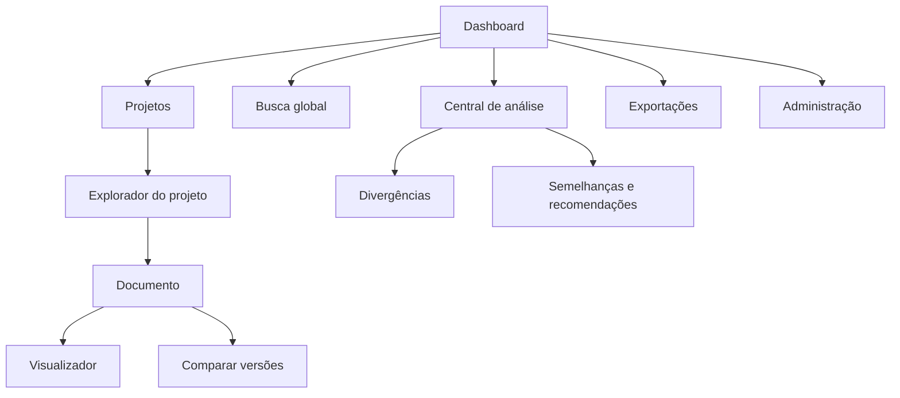

# UX e layout da aplicação

## 1. Direção visual

Interface profissional, densa sem ser confusa, inspirada na previsibilidade do Explorer e em ferramentas técnicas. Priorizar desktop; responsividade para tablets e consulta móvel.

- Navegação lateral persistente.
- Busca global sempre visível.
- Breadcrumbs e contexto da pasta/projeto.
- Tabela e grade com alternância.
- Painel de detalhes e preview.
- Estados claros: indexando, disponível, parcial, falha, não suportado, revisão necessária.
- Acessibilidade por teclado, foco visível, contraste e nomes acessíveis.

## 2. Mapa de navegação



## 3. Layout principal — Explorador

```text
┌──────────────────────────────────────────────────────────────────────────────┐
│ GED   [ Buscar projetos, desenhos, códigos, trechos...          ] [Perfil] │
├───────────────┬──────────────────────────────────────────┬───────────────────┤
│ WORKSPACE     │ Projetos > SP-330 > Ramo 200             │ DETALHES          │
│               │ [Importar] [Nova pasta] [Filtros] [Ordenar]│                   │
│ Dashboard     ├──────────────────────────────────────────┤ Nome              │
│ Projetos      │ Nome             Tipo   Revisão  Data     │ Título            │
│ Explorar      │ 📁 Estruturas    Pasta  —        —        │ Código            │
│ Busca         │ 📁 Drenagem      Pasta  —        —        │ Disciplina        │
│ Divergências  │ 📄 Ponte E-201   DWG    R4       ...      │ Revisão           │
│ Comparações   │ 📄 Ponte E-202   DWG    R13      ...      │ Hash / origem     │
│ Recomendações │ 📄 Relatório     PDF    R2       ...      │ Extração/confiança│
│ Exportações   │                                          │                   │
│ Administração│ [Preview rápido / miniatura / propriedades]│ [Abrir] [Comparar]│
└───────────────┴──────────────────────────────────────────┴───────────────────┘
```

## 4. Telas e comportamento

### Dashboard
- Projetos recentes e favoritos.
- Documentos indexados, pendentes e com falha.
- Divergências abertas por severidade.
- Atividade recente.
- Recomendações recentes e atalhos para continuar trabalho.

### Explorador
- Árvore de pastas e breadcrumbs.
- Modos lista, grade e detalhes.
- Colunas configuráveis e salváveis por usuário.
- Ordenação por nome, tipo, revisão, data, tamanho, código, disciplina e confiança.
- Filtros combináveis e chips removíveis.
- Seleção múltipla, ações em lote e operações permitidas por papel.
- Preview seguro no painel lateral.
- Mostrar origem física, projeto lógico e versões sem misturá-los.
- Atalhos de teclado e menu de contexto.

### Busca global
- Busca por código exato, título, trecho, rodovia, ramo, disciplina, material, tipologia e texto.
- Sugestões e correção tolerante a erros.
- Filtros facetados com contagem.
- Alternar busca literal, avançada e semântica.
- Explicar os motivos da relevância.

### Visualizador
- PDF: zoom, pan, rotação, miniaturas, pesquisa de texto, seleção e navegação por páginas.
- Imagem: zoom, pan e metadados.
- CAD: visualizador compatível com o formato/versão, camadas, layouts e propriedades quando suportado.
- BIM/IFC: árvore de elementos, propriedades, categorias e visualização 3D quando suportado.
- Planilhas: visualização tabular sem executar macros.
- Documento Office: preview convertido em ambiente isolado.
- Sempre indicar quando preview é derivado/conversão e oferecer acesso ao original autorizado.

### Divergências
- Lista por severidade, regra, projeto, data e estado.
- Cada achado mostra valores conflitantes lado a lado.
- Evidência navegável até folha/página/entidade.
- Ações: confirmar, rejeitar, corrigir metadado, aceitar risco, atribuir e comentar.
- Histórico e responsável pela decisão.

### Comparação
- Revisão anterior versus atual.
- Metadados lado a lado.
- PDF: comparação visual/diferenças de texto quando aplicável.
- CAD: comparação geométrica somente se o adaptador e a versão suportarem; indicar tolerância e limitações.
- IFC: comparar GUIDs, propriedades e elementos quando estáveis.
- Relatório exportável com evidências.

### Recomendações
- Projetos e documentos similares.
- Motivos: mesma tipologia, trecho, disciplina, sistema construtivo, dimensões ou termos.
- Mostrar divergências e diferenças relevantes para evitar falsa equivalência.
- Ações de feedback: útil, não útil, motivo.

## 5. Estados e linguagem

Nunca mostrar somente “Erro”. Usar:
- Aguardando processamento.
- Extração concluída.
- Extração parcial — alguns campos não puderam ser lidos.
- Formato reconhecido, mas ainda não suportado.
- Arquivo em quarentena.
- Revisão humana necessária.
- Preview indisponível; download do original permitido.
- Divergência potencial — requer validação.

## 6. Princípios de confiança

- Diferenciar valor extraído, valor informado e valor validado.
- Nunca substituir silenciosamente metadado confirmado.
- Mostrar data, autor e método de extração.
- Preview não deve ser tratado como documento de emissão.
- Ações destrutivas exigem confirmação e permissão.
- Exportação deve indicar filtros aplicados e itens omitidos.
